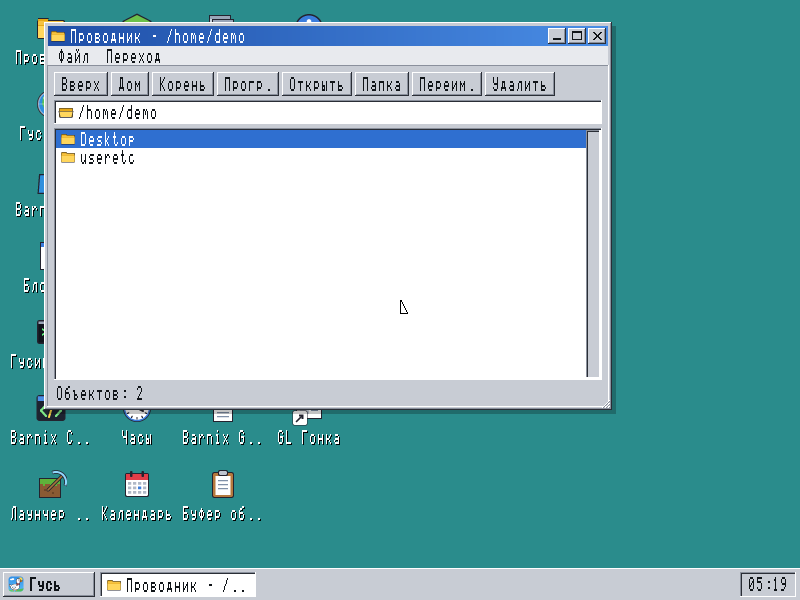

# Barnix

Barnix — самодельная 32-битная операционная система для x86 со своим ядром.
Она загружается с CD/USB (Legacy BIOS и UEFI), работает с дисками ext2,
поддерживает USB, сеть и Wi-Fi, запускает собственные программы и статические
Linux-программы i386. У неё есть оконная среда Happy Gouse с браузером, играми
и средой разработки.



## Возможности

- **Ядро**: защищённый режим, ring 3, многоядерность (SMP), загрузка через GRUB
  в Legacy BIOS и UEFI.
- **Диски**: ext2 (до 5 ГиБ), IDE, SATA/AHCI, NVMe, VirtIO, USB-флешки,
  разделы MBR/GPT, установщик Barnix Setup.
- **Устройства**: USB (UHCI/OHCI/EHCI/xHCI, хабы, клавиатура и мышь),
  звук (Intel HD Audio, PC speaker), графика VBE/GOP.
- **Сеть**: Intel PRO/1000, Realtek, AMD PCnet, Wi-Fi WPA2, TCP, HTTPS;
  команды `get`, `git clone`, пакетный менеджер `brm`.
- **Совместимость с Linux**: статические ELF i386, `fork`/`execve`/`pipe`,
  конвейеры `a | b` и перенаправления в оболочке `bssh`.
- **Приложения**: Happy Gouse (окна, браузер с JavaScript, блокнот, Paint,
  калькулятор), Barnix Execute, Barnocraft, Java-машина с OpenGL, язык Nova,
  GCC и Python внутри системы.
- **Пользователи и права**: вход с паролем, `su`/`sudo`, права на файлы.

## Быстрый старт (Linux)

Нужны: GCC с поддержкой `-m32`, binutils, GRUB, xorriso, mtools, QEMU,
e2fsprogs, Python 3 с Pillow, шрифты Liberation и JDK (для Java-программ и Nova).

```sh
# Arch Linux
sudo pacman -S --needed base-devel lib32-glibc grub libisoburn mtools \
    qemu-system-x86 e2fsprogs python python-pillow python-cryptography \
    ttf-liberation jdk-openjdk zlib curl
# Debian / Ubuntu
sudo apt install build-essential gcc-multilib grub-pc-bin grub-efi-amd64-bin \
    grub-common xorriso mtools qemu-system-x86 e2fsprogs python3 python3-pil \
    python3-cryptography curl \
    fonts-liberation default-jdk-headless zlib1g-dev

make barnix.iso   # собрать образ системы
make run          # запустить в QEMU с постоянным диском
make run-cd       # запустить только с CD, без диска
```

Установочные образы (`make setup`) дополнительно требуют собранного порта GCC
для Barnix (`live-ext2-gcc.img`, см. [справочник](docs/REFERENCE.md)).

Программы Barnix используют SSE2: нужен процессор Pentium 4 / Athlon 64 или новее
(то же требование, что у Windows 10).

При первом запуске Barnix попросит задать пароль root и создать пользователя.
Команда `help` покажет список команд. `Ctrl+Alt+F` переключает QEMU на полный экран.

## Windows

Собирать Barnix проще всего в **WSL2** (Ubuntu) по инструкции для Linux выше.
Чтобы просто запустить готовый образ, нужен только
[QEMU для Windows](https://qemu.weilnetz.de/w64/):

```bat
qemu-system-i386 -m 2048M -cdrom barnix.iso
```

## Структура проекта

```text
kernel/          ядро: загрузка, память, SMP, таймер, ELF, язык и текст
  fs/            ext2, VFS, диски, разделы, права доступа
  linux/         совместимость с Linux: системные вызовы, процессы, память
  shell/         оболочка bssh и разбор командной строки
drivers/         драйверы: usb/, net/ (включая Wi-Fi), storage/, input/, video/, sound/
include/abi/     общий интерфейс ядра и программ (app_abi.h и др.)
include/uapi/    номера системных вызовов Linux
apps/            программы Barnix: команды, игры, Happy Gouse, Java-машина
userland/        Linux-программы и пробники для тестов
barnixiolib/     маленькая библиотека stdio для программ
BDK/             SDK для сторонних программ (C, C++, C#)
Setup/           установщик Barnix Setup
scripts/         сборка образов, установка программ, ресурсы
tools/           язык Nova, сборка Python и GCC для Barnix
tests/           тесты
docs/            документация и встроенное руководство
```

Промежуточные файлы сборки (`.o`, `.d`) складываются в `build/`.
Готовые образы (`barnix.iso`, `*.img`) появляются в корне и в git не попадают.

## Тесты

```sh
make check       # быстрые тесты без эмулятора (секунды)
make check-all   # плюс загрузка Barnix в QEMU без окна (несколько минут)
```

Отдельные наборы — `make test-shell`, `make test-linux`, `make test-usb` и другие —
описаны в [справочнике](docs/REFERENCE.md). Каждый `push` на GitHub
автоматически собирает систему и прогоняет тесты (GitHub Actions).

`make WERROR=-Werror` превращает предупреждения компилятора в ошибки. Сейчас
проект собирается без единого предупреждения.

## Документация

- [Подробный справочник](docs/REFERENCE.md): загрузка, ext2, команды, USB, BDK, Execute
- [Совместимость с Linux](docs/README-LINUX-REWRITE.md)
- [Приложения и Happy Gouse](docs/NEW_APPS.md)
- [Права доступа](docs/PERMISSIONS_README.md)
- [Разметка дисков](docs/PARTITIONING.md)
- [USB](docs/USB.md)
- [Установщик](Setup/README.md) · [BDK](BDK/README.md)

## Публикация изменений

```sh
./scripts/update-repo.sh "Что изменилось"
```

Скрипт проверяет, что `origin` указывает на этот репозиторий, коммитит все
изменения и отправляет их на GitHub. Подробнее — `--help`.
